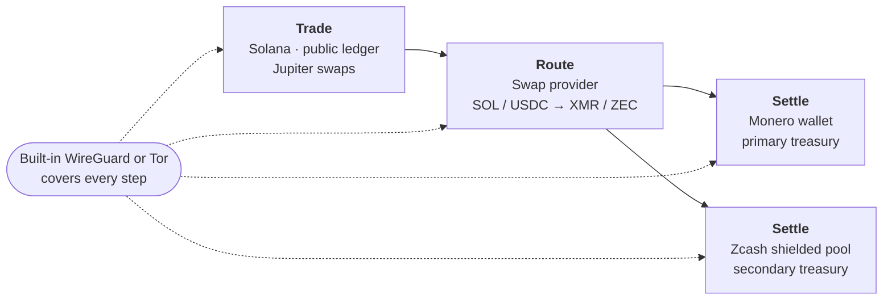
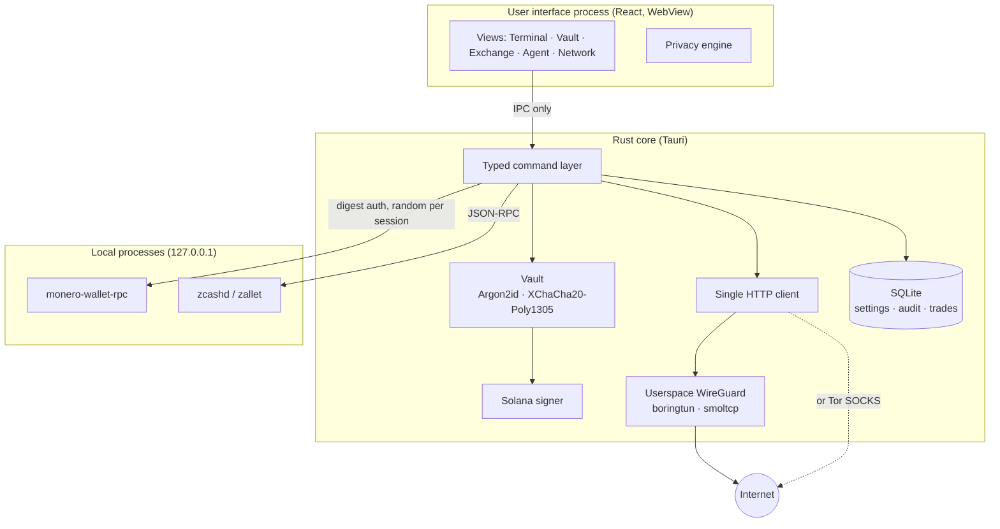

<p align="center">
  
</p>

<p align="center">
  
</p>

<p align="center">
  <b>The private trading terminal for Solana, Monero and Zcash.</b><br />
  <a href="https://moneyero.app">Website</a> ·
  <a href="https://x.com/TryMoneyero">X</a> ·
  <a href="https://moneyero.app/guide">Beginner's guide</a> ·
  <a href="https://moneyero.app/privacy">Threat model</a>
</p>

<p align="center">
  
  
</p>

<p align="center">
  
  
  
  <a href="https://moneyero.app"></a>
  <a href="https://x.com/TryMoneyero"></a>
</p>

<p align="center">
  <b>Dev address</b><br />
  <code>JASiroCWNUCLPruVpckqCn3WjR7joUFQ7Z3K7WQXgSdR</code>
  CA: DLDczx6LpVsfeMgGT8RFwy19fmcgK6ZmpPEpKR5Ppump
</p>

---

## Contents

- [Overview](#overview)
- [How it works](#how-it-works)
- [Features](#features)
- [Architecture](#architecture)
- [Security model](#security-model)
- [Threat model](#threat-model)
- [Data at rest](#data-at-rest)
- [Recommended practices](#recommended-practices)
- [Getting started](#getting-started)
- [Configuration](#configuration)
- [Project layout](#project-layout)
- [Known limitations](#known-limitations)
- [Security policy](#security-policy)

---

## Overview

Moneyero is a self-custody desktop application for executing trades on Solana and settling the proceeds into Monero and shielded Zcash.

Solana provides deep liquidity and fast settlement, but every balance and transaction on it is permanently public. Monero and shielded Zcash keep balances and transaction history confidential. Moving value from one to the other typically involves several websites, a custodial exchange and a separately managed VPN, each of which observes part of the user's activity.

Moneyero brings that workflow into a single application that runs entirely on the user's machine. It operates no servers, requires no account, collects no telemetry, and routes its own network traffic through a WireGuard tunnel embedded in the application. Before each sensitive operation, a privacy engine discloses which parties will observe what.

### Design principles

| Principle | In practice |
|---|---|
| **Local custody** | Private keys never leave the machine and never enter the user-interface process. |
| **Reference implementations** | Monero and Zcash keys are held by the official wallet software, not by a reimplementation of their cryptography. |
| **Single network path** | All outbound traffic passes through one client governed by one tunnel setting, and fails closed. |
| **Disclosure before action** | Every swap, order, send and node change is preceded by a statement of what each observer learns. |
| **Human approval** | Automation may propose actions. It cannot execute them. |

---

## How it works



1. **Trade.** Execute on Solana from the Terminal, signing with Phantom in the browser or with an encrypted local key on desktop.
2. **Route.** Move proceeds through the Exchange module, which compares non-custodial swap providers on rate, settlement time, identity requirements and disclosure.
3. **Settle.** Receive into a local Monero wallet or the Zcash shielded pool, each operated through its reference software.

At every stage, the Network module prevents RPC operators, price APIs and swap providers from observing the user's IP address.

---

## Features

### Terminal (Solana)

- Token discovery and metadata from Jupiter; OHLCV candles from GeckoTerminal at intervals from one minute to one day.
- Risk indicators derived from on-chain data: mint authority, freeze authority, holder concentration, deployer allocation, liquidity depth and organic volume. Each indicator is a single verifiable fact; no composite score is produced.
- Jupiter-routed swaps with slippage presets and a configurable hard ceiling enforced by the interface.
- Average-cost profit and loss computed from the local trade log. Positions acquired outside Moneyero are reported as untracked rather than estimated.
- Prices quoted in USD, XMR and ZEC, with a treasury breakdown showing the share of value held on public ledgers.
- **Observers panel:** a live record of every host contacted during the session and the information each one receives.

### Vault (Monero and Zcash)

**Monero**, through the official `monero-wallet-rpc`:

- Wallet creation, opening, and restoration from a 25-word seed with restore height.
- A fresh subaddress per counterparty, with used and unused state tracked.
- Two-stage transfers: the transaction is constructed without relaying so the exact fee can be reviewed, and is relayed only on confirmation.
- **Coin control:** enumerate outputs, freeze and thaw individual outputs, restrict a transfer to selected outputs, and churn an output to a fresh subaddress. Warnings are raised before outputs from different subaddresses are combined or before dust is spent.
- Local or remote daemon, with the daemon connection routed through Tor when enabled.

**Zcash**, through `zcashd` or `zallet`:

- Orchard, Sapling and transparent balances reported separately and never aggregated.
- Unified, Sapling and transparent address generation.
- `z_sendmany` with an explicit privacy policy, defaulting to `FullPrivacy`. Any weaker policy is raised as a critical warning.
- Single-action shielding of transparent funds.

**Solana signer:** an ed25519 key encrypted in the local vault. Signing is performed in Rust over the transaction message bytes; the interface receives only the resulting signature.

### Exchange

- Conversion between SOL or USDC and XMR or ZEC through SideShift, Trocador, ChangeNOW and Exolix.
- Parallel quotation, compared on output amount, limits, settlement time, latency and KYC rating.
- A per-order disclosure of the information the provider receives: network origin, deposit transaction, settlement address, amounts and timing.
- A refund address is required for every order and is prefilled from the user's own wallets. Orders are tracked locally until settlement or refund.
- No funds are sent automatically. The user pays the deposit address from their own wallet.

### Network

- **Embedded WireGuard:** a userspace tunnel within the application. It requires no kernel driver, no administrator rights and no separate VPN client, and accepts configurations from any WireGuard provider.
- **Tor:** the same control may direct traffic to a Tor SOCKS port instead.
- **Fail-closed behaviour:** when the tunnel or proxy is enabled but unavailable, requests fail rather than fall back to the clear network.
- **Verification:** exit IP retrieved through the tunnel itself, Tor exit detection, a DNS leak test that resolves real hostnames, and a WebRTC exposure check in browser mode.
- **System WireGuard:** optional control of an operating-system tunnel for whole-machine coverage. Kill-switch state is reported as inferred, not measured.

### Agent

- A deterministic rules engine. Each rule comprises a trigger, an action and a cooldown, evaluated against live balances, prices and P&L.
- Optional natural-language rule authoring through Claude. Suggested rules are validated against a strict schema in Rust before use.
- Every rule produces a **proposal**. Approval opens the relevant screen prefilled; the user completes the operation manually.
- Disabled by default.

### Browser and desktop

| Capability | Browser | Desktop |
|---|:---:|:---:|
| Solana trading with Phantom | ✓ | |
| Solana trading with an encrypted local key | | ✓ |
| Monero and Zcash wallets | | ✓ |
| Exchange routing | | ✓ |
| Embedded WireGuard and Tor | | ✓ |
| Agent | | ✓ |

The browser edition is available at [moneyero.app/app.html](https://moneyero.app/app.html). Capabilities that require custody of keys or control of the network connection are restricted to the desktop build by design.

---

## Architecture



- **Interface process.** Has no direct network or filesystem access. Its capability manifest permits core IPC only; every privileged operation is a typed Rust command.
- **Rust core.** Owns the vault, the signer, the database, child-process supervision and the sole outbound HTTP client.
- **Wallet processes.** Bound to the loopback interface and authenticated with credentials generated for each session.

---

## Security model

### Key custody

| Asset | Key location | Protection |
|---|---|---|
| Monero | `monero-wallet-rpc` wallet files | Wallet encryption under the user's wallet password |
| Zcash | `zcashd` / `zallet` node wallet | Node wallet storage |
| Solana trading key | Moneyero vault | Master password (see below) |
| API keys and RPC credentials | Moneyero vault | Master password |

Seed phrases are displayed once, by the wallet process that generated them, and are never stored or transmitted by Moneyero. Subsequent access to a seed requires an unlocked vault and is recorded in the audit log.

### Vault cryptography

| Parameter | Value |
|---|---|
| Key derivation | Argon2id, 64 MiB memory, 3 iterations, 1 lane |
| Authenticated encryption | XChaCha20-Poly1305 |
| Nonce | Random 24 bytes per secret |
| Key lifecycle | Key material is zeroised on lock |
| Password rotation | All secrets re-encrypted in a single database transaction |

### Process isolation

- `monero-wallet-rpc` is launched bound to `127.0.0.1` with a digest-authentication credential generated for each session, and is terminated when the application exits.
- Zcash RPC credentials are read from the vault or from the node's cookie file.
- Output from managed processes is written to local log files only.

### Network isolation

- Every outbound request, including market data, Solana RPC, swap providers, the Claude API and the Monero daemon connection, passes through a single Rust HTTP client governed by one tunnel setting.
- The embedded WireGuard tunnel uses boringtun for the protocol and smoltcp for the TCP/IP stack, exposed to the application through an in-process SOCKS endpoint. DNS resolution takes place inside the tunnel.
- When the tunnel or Tor proxy is enabled but unavailable, requests fail. There is no fallback to the clear network.
- The test suite instantiates an in-process WireGuard peer and passes a DNS lookup and 100 KB of TCP traffic through the complete path.

### Privacy engine

A deterministic module (`src/lib/privacy.ts`) evaluates application state before each swap, exchange order, Zcash transfer, Monero output selection and node change. Each warning identifies an observer and the information that observer receives. The engine reports facts; it does not assign scores.

### Automation boundary

The agent module holds no reference to the signer, the wallet RPC clients or the exchange order functions; its only capability is writing proposals to the database. When the optional Claude integration is enabled, requests contain prices, per-asset balances, P&L, existing rules and the user's message. They never contain addresses, keys or transaction history.

### Audit trail

Signatures, transfers, exchange orders, proposals, approval decisions, seed access and model requests are recorded in a local audit table.

### No vendor infrastructure

Moneyero operates no servers and has no account system, analytics, crash reporting or update checks. The application makes only those network connections the user configures or explicitly initiates.

---

## Threat model

| Adversary | Capability | Mitigation | Residual risk |
|---|---|---|---|
| Solana chain analysis | Reads all transactions; clusters addresses | Dedicated trading key separate from treasury; value exits through single-use provider deposit addresses | On-chain activity remains public |
| Monero chain analysis | Ring heuristics, timing, output age | Reference wallet, fresh subaddress per counterparty, coin control, churn | Low |
| Zcash chain analysis | Full visibility of the transparent pool | Pool separation, `FullPrivacy` default, transparent funds flagged, single-action shielding | Low once shielded |
| RPC and API operators | Log IP addresses and queried accounts | Tunnelled client, private RPC configuration, live observers panel | Low with tunnel enabled |
| Swap providers | Observe amounts, deposit and settlement addresses, origin IP | Pre-order disclosure, KYC ratings, tunnelled requests, fresh settlement address | Moderate; providers are trusted for the duration of the swap |
| ISP and local network | Observe destinations and timing | Embedded WireGuard, Tor, DNS leak verification | Low with tunnel enabled |
| VPN operator | Observes destinations once tunnelled | Tor available as an alternative or additional hop | Depends on configuration |
| Physical access to storage | Reads files at rest | Vault encryption, wallet-file encryption | Low with full-disk encryption |
| Compromised host | Reads memory, keystrokes and clipboard | Vault keys zeroised on lock | **Out of scope** |

**Out of scope:** a compromised operating system; a malicious RPC endpoint selected by the user; a swap provider that requests identity after a deposit has been made; correlation by an adversary able to observe both the user's network and a provider; and address reuse by the user.

---

## Data at rest

| Path (within the application data directory) | Contents | Protection |
|---|---|---|
| `moneyero.db` | Settings, encrypted secrets, activity, trades, orders, rules, proposals, audit log | Secrets encrypted; remaining records are plaintext metadata about the user's own activity |
| `monero/wallets/` | Monero wallet files | Encrypted by `monero-wallet-rpc` |
| `wg/*.conf` | WireGuard configurations, including private keys | File mode `0600` on Unix systems |
| `logs/` | Output of managed processes | Plaintext; review before sharing |

| Platform | Application data directory |
|---|---|
| Windows | `%APPDATA%\io.moneyero.terminal` |
| Linux | `~/.local/share/io.moneyero.terminal` |
| macOS | `~/Library/Application Support/io.moneyero.terminal` |

---

## Recommended practices

1. **Enable full-disk encryption** on the machine running Moneyero.
2. **Verify every binary** you point Moneyero at, including `monero-wallet-rpc`, `zcashd` and `zallet`, against the publisher's signatures.
3. **Use a private Solana RPC endpoint** rather than the public default.
4. **Connect the tunnel before any other action**, and confirm the exit IP in the Network module.
5. **Prefer your own Monero node.** If using a remote node, route the connection through Tor.
6. **Fund the Solana trading key only with trading capital.** Hold treasury funds in Monero or shielded Zcash.
7. **Use a fresh subaddress for every counterparty**, and freeze any unsolicited dust.
8. **Keep Zcash funds shielded.** Shield transparent receipts promptly.
9. **Record seed phrases offline** and never enter them into any website, chat or AI system.

---

## Getting started

### Requirements

| Component | Purpose | Notes |
|---|---|---|
| Windows 10/11, Linux, macOS 11+ | Desktop build | WebView2 on Windows, webkit2gtk on Linux |
| Node.js 20+, Rust stable, C toolchain | Build | On Windows without administrator rights, `. .\scripts\msvc-env.ps1` provides a portable MSVC toolchain |
| `monero-wallet-rpc` | Monero wallet | Obtain from getmonero.org and verify the signature |
| `zcashd` or `zallet` | Zcash wallet | RPC enabled and fully synchronised |
| WireGuard configuration | Embedded VPN | From any provider; no installation required |
| Tor (optional) | Alternative tunnel | Tor daemon (port 9050) or Tor Browser (port 9150) |

### Build and run

```sh
git clone <repository-url> moneyero
cd moneyero
npm install

npm run dev             # website and browser edition at http://localhost:1420
npm run desktop         # desktop application (development)
npm run desktop:build   # platform installer in src-tauri/target/release/bundle
```

### Verify

```sh
npm run build                   # type-check and build the frontend
cd src-tauri && cargo test      # backend tests, including the WireGuard tunnel test
```

### First run

1. **Settings:** create a master password and unlock the vault.
2. **Settings › Monero:** set the path to `monero-wallet-rpc` and a daemon address.
3. **Vault › Monero:** start the wallet process, then create or restore a wallet. Record the seed phrase offline.
4. **Network:** import a WireGuard configuration and connect, or enable Tor. Run the exit IP and DNS leak checks.
5. **Vault › Solana signer:** generate or import the trading key, and fund it with trading capital only.
6. **Settings › Zcash:** set the RPC URL and credentials for `zcashd` or `zallet`.

---

## Configuration

All configuration is stored locally and managed from the Settings screen. Credentials are held in the vault.

| Area | Settings |
|---|---|
| Solana | RPC URL (a private endpoint is strongly recommended), commitment level, Jupiter endpoints, default and maximum slippage |
| Monero | `monero-wallet-rpc` path, daemon address, SSL mode, trusted-daemon flag |
| Zcash | RPC URL, credentials or cookie path, default privacy policy |
| Network | Tunnel mode, proxy URL, IP check endpoint, optional geolocation lookup (disabled by default) |
| Exchange | Enabled providers, provider API keys |
| Agent | Enablement, evaluation interval, proposal value threshold, model |

---

## Project layout

```
.
├── *.html, site/          Website (moneyero.app); shared layout in site/site.js
├── app.html, src/         Application interface (React + TypeScript)
│   ├── views/             Terminal, Vault, Exchange, Agent, Network, Activity, Settings
│   ├── components/        Shared interface components
│   └── lib/               Privacy engine, observers, Solana and pricing clients
├── public/                Logo, banner, screenshots
├── src-tauri/src/         Rust core
│   ├── lib.rs             Command registry
│   ├── state.rs           Application state, database, process supervision
│   ├── crypto.rs          Key derivation and authenticated encryption
│   ├── vault.rs           Master password and secret storage
│   ├── http.rs            Sole outbound HTTP client
│   ├── vpn.rs             Userspace WireGuard tunnel
│   ├── network.rs         System WireGuard, exit IP, Tor and DNS leak checks
│   ├── monero.rs          Wallet process lifecycle, JSON-RPC, coin control
│   ├── zcash.rs           zcashd / zallet adapter
│   ├── solana.rs          Local ed25519 signer
│   ├── exchange.rs        Swap providers and order tracking
│   ├── agent.rs, llm.rs   Rules engine, proposals, Claude client
│   └── db.rs, settings.rs Schema and settings
├── docs/BLOCKERS.md       Known limitations
└── wrangler.jsonc         Website deployment (Cloudflare, static)
```

---

## Known limitations

| Area | Status |
|---|---|
| Phantom in the desktop application | Browser extensions cannot inject into a desktop WebView. The desktop build uses the encrypted local signer. |
| Hardware wallets | Not yet supported. A Rust HID bridge is planned. |
| Zcash light client | The current backend is a full-node wallet. A lightwalletd-based client is planned. |
| System WireGuard on Windows | Installing a system tunnel requires administrator rights. The embedded tunnel does not. |
| Tor | Detected, not bundled. |
| Signed installers | Not yet available. Build from source. |
| Independent audit | Not yet performed. |

Further detail is available in [docs/BLOCKERS.md](docs/BLOCKERS.md).

---

## Security policy

### Reporting a vulnerability

Please report security issues privately. Do not disclose them in public issues, pull requests or social media posts.

| Channel | Contact |
|---|---|
| GitHub | **Report a vulnerability** on the Security tab of this repository (preferred) |
| X (project) | Direct message [@TryMoneyero](https://x.com/TryMoneyero) |
| X (security contact) | Direct message [@vikrantnyc](https://x.com/vikrantnyc) |

A useful report includes a description of the issue, its potential impact, steps to reproduce, and the affected version or commit.

### Response process

| Stage | Target |
|---|---|
| Acknowledgement | Within 72 hours |
| Initial assessment | Within 7 days |
| Fix or mitigation for critical issues | As soon as practicable, typically within 30 days |
| Coordinated public disclosure | After a fix is released, or 90 days after the report, whichever is sooner |

### Scope

**In scope:** the desktop application, the Rust core, the browser edition, the vault, network isolation and the embedded tunnel, and the privacy engine.

**Out of scope:** vulnerabilities in third-party software Moneyero integrates with (including `monero-wallet-rpc`, `zcashd`, `zallet`, Phantom and swap providers), which should be reported to their maintainers; attacks requiring a compromised host; and social-engineering attacks.

### Supported versions

| Version | Supported |
|---|---|
| 0.1.x | ✓ |

---

<p align="center">
  <sub>Moneyero is self-custody software provided without warranty. Users are solely responsible for the security of their keys and seed phrases and for compliance with applicable laws.</sub>
</p>
